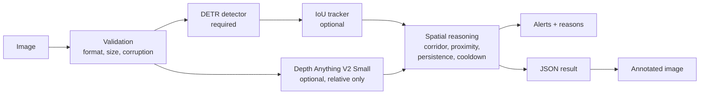
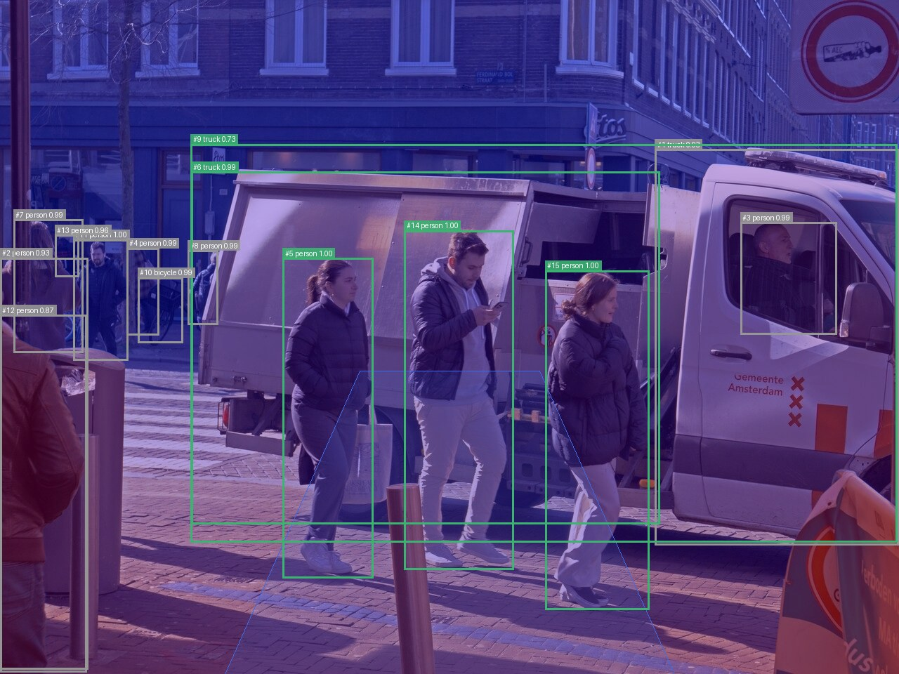

# VisIA Spatial Intelligence

Research-oriented computer vision pipeline combining object detection, depth estimation and spatial reasoning for real-time scene understanding.

> **Research prototype. Not a certified navigation, mobility or safety system.** It does not guarantee pedestrian safety and must not be used to guide anyone or to avoid traffic.

## The problem

Many assistive and mobility tools need to know what is in front of a camera and whether it sits on the walking path. A detector alone says *what* is there, not *where it matters*. Monocular depth alone gives relative, uncalibrated closeness. Turning either into a useful, explainable statement about a walking corridor needs a reasoning layer, and that layer must say why it raised an alert and when it has too little evidence to alert at all.

VisIA is a prototype of that layer. It keeps every intermediate output (detections, track IDs, relative depth, corridor overlap, persistence) and records a human-readable reason for each risk decision.

## Architecture



Details are in [docs/ARCHITECTURE.md](docs/ARCHITECTURE.md).

## Implemented features

- Input validation: JPEG, PNG, BMP and WebP only; size, dimension and corruption checks (`validation.py`).
- Object detection with `facebook/detr-resnet-50` (Apache-2.0), restricted to navigation-relevant COCO classes, behind a replaceable `ObjectDetector` protocol.
- Frame-to-frame tracking with a greedy IoU tracker and documented failure modes.
- Relative monocular depth with `depth-anything/Depth-Anything-V2-Small-hf` (Apache-2.0). Output is normalised inverse depth; no metres are reported.
- Interpretable spatial reasoning: corridor overlap, bottom-centre test, relative proximity, consecutive-frame persistence, alert cooldown. Every rule is unit tested.
- Explicit degradation: disabled or failed optional features are listed with their reason in every result.
- Annotated image rendering (boxes, track IDs, risk colours, corridor, optional depth overlay, alert banner).
- CLI (`visia info`, `visia analyze`, `visia benchmark`), Streamlit demo, FastAPI service.
- Runtime benchmark with cold-start and steady-state timings, recorded with hardware and load.

## Not implemented yet

- Walkable-area segmentation. No checkpoint has passed the licence audit.
- Video decoding. The tracker and reasoner are frame-sequence ready, but no video reader is included.
- Accuracy evaluation (detection precision/recall/mAP, alert metrics, ablations). No labelled split exists yet. See [docs/EVALUATION.md](docs/EVALUATION.md).

## Installation

Requirements: macOS or Linux, Python 3.11, [uv](https://docs.astral.sh/uv/).

```bash
git clone <this repository>
cd visia-spatial-intelligence
uv sync --frozen --all-extras     # installs locked dependencies, including Streamlit and FastAPI
uv run pytest                     # unit tests, no model downloads
```

PyTorch is pinned to 2.2.x because Intel Macs have no newer PyTorch wheels. Linux installs use CPU-only PyTorch from the official index.

Model weights (about 270 MB) are downloaded from Hugging Face on first use, pinned by commit hash in `configs/default.yaml`. To run the real-model integration tests:

```bash
make test-integration
```

## Quick start

```bash
uv run visia analyze data/samples/amsterdam_shopping_street_cc0.jpg --out-dir artifacts/sample --show-depth
```

This writes `artifacts/sample/annotated.png` and `artifacts/sample/result.json`.

Example output (generated by the command above, CC0 photo from Wikimedia Commons):



A still image never raises alerts, because persistence across frames cannot be shown from one photo. The reasons for each object are still recorded in the JSON.

## Application and API

Streamlit demo (upload an image, inspect every stage, download the annotated image and JSON):

```bash
uv run --extra app streamlit run app/streamlit_app.py
```

FastAPI service:

```bash
uv run --extra api uvicorn visia_spatial_intelligence.api.app:app --port 8000
curl -F "image=@data/samples/amsterdam_shopping_street_cc0.jpg" "http://localhost:8000/v1/analyze?depth=true"
```

Endpoints: `GET /health`, `GET /info`, `POST /v1/analyze`. The API accepts uploads only, with a size limit, a timeout, and no filesystem or model-download endpoints. See the code docstring in `src/visia_spatial_intelligence/api/app.py`.

Docker (CPU, Linux):

```bash
docker build -t visia-spatial-intelligence:dev .
docker run --rm -p 8000:8000 visia-spatial-intelligence:dev
```

## Reproducible evaluation commands

```bash
uv run visia info                                    # hardware, package versions, pipeline config
uv run visia benchmark data/samples/amsterdam_shopping_street_cc0.jpg --runs 3 --warmup 1 \
  --out artifacts/benchmarks/latest.json
```

## Measured results

Only measured values are listed. There are no accuracy results yet.

**Runtime, single 1280×960 image, Intel Core i7-1068NG7 CPU, 32 GB RAM, macOS 26.6.2, no GPU.** Measured while the machine was heavily loaded by other applications, so these are pessimistic. Re-measurement on an idle machine is pending. Details and raw JSON are in [docs/EVALUATION.md](docs/EVALUATION.md).

| Measure | Value |
|---|---|
| Detector cold start (weights load) | see `docs/results/` |
| Depth cold start | see `docs/results/` |
| Steady-state end-to-end latency | see `docs/results/` |

The values are filled in from the saved benchmark JSON once the final run is complete.

## Licences

- Project code: Apache-2.0 (see [LICENSE](LICENSE)).
- DETR weights (`facebook/detr-resnet-50`): Apache-2.0, COCO-trained. COCO image-level licence provenance is an open note.
- Depth Anything V2 Small weights: Apache-2.0. Base, Large and Giant are CC-BY-NC and are **not** used.
- YOLO and all AGPL components are **not** used.
- Full audit with checksums and verification dates: [docs/LICENSE_AUDIT.md](docs/LICENSE_AUDIT.md).

## Limitations

Read [docs/LIMITATIONS.md](docs/LIMITATIONS.md) before drawing any conclusion from the output. The main points: depth is relative and uncalibrated, the walking corridor is a fixed assumed trapezoid, risk levels are heuristic, COCO does not cover many real obstacles, the pipeline is not real-time on the development CPU, and nothing has been evaluated on labelled data.

## Roadmap

1. Re-measure runtime on an idle machine; add more images with verified licences.
2. Choose and audit a labelled evaluation set; implement detection metrics (precision, recall, F1, mAP) with a pinned evaluation library.
3. Define the alert ground-truth protocol on labelled video; measure alert precision, recall, false alerts per minute and latency.
4. Ablations A–D on the same split.
5. Walkable-area segmentation, only after a licence audit passes.
6. Lower-latency detector candidate (RT-DETR, Apache-2.0 tag) evaluated against the same protocol.

## Skills demonstrated

Computer vision pipeline design; transformer-based object detection and monocular depth inference; typed Python architecture with replaceable model interfaces; deterministic rule-based reasoning with unit tests; licence auditing of models and dependencies; reproducible environments (uv lockfile, pinned weights, CPU-only Linux builds); CI with Ruff and pytest; Streamlit and FastAPI interfaces with input limits; honest benchmarking with cold-start and steady-state separation.
