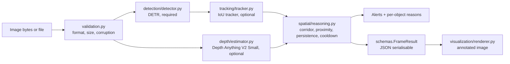

# Architecture

## Pipeline

## Stage responsibilities

| Stage | Module | Input | Output | Failure behaviour |
|---|---|---|---|---|
| Input validation | `validation.py` | bytes or a local path | RGB `PIL.Image` | Raises `InputValidationError`; nothing else runs |
| Detection | `detection/detector.py` | RGB image | `Detection` list (navigation classes only) | Raises `ModelUnavailableError`; the frame cannot be analysed without a detector |
| Tracking | `tracking/tracker.py` | detections of one frame | the same detections with `track_id` | Disabled when configured off; recorded in `disabled_features` |
| Depth | `depth/estimator.py` | RGB image | `DepthMap` (relative inverse depth, `[0, 1]`) | Any exception disables depth for that frame; recorded in `disabled_features` |
| Spatial reasoning | `spatial/reasoning.py` | detections, optional depth map, frame index | `ObstacleAssessment` per object, `Alert` list | Pure computation; no model dependency |
| Visualisation | `visualization/renderer.py` | image, result, depth | annotated image copy | Pure computation |
| Orchestration | `pipeline.py` | config, models | `AnalysisOutput` | Enforces the rules above |
| Interfaces | `cli.py` | arguments | files and exit codes | Exit 2 for input or config errors, exit 3 for a missing model |
| Evaluation | `evaluation/benchmark.py` | pipeline, images | timing report JSON | Propagates model errors |

## Design decisions

* **Replaceable models.** `ObjectDetector` is a `Protocol`. Tests inject fakes, and a
  different detector can be used without changing the pipeline.
* **Lazy loading.** Importing the package and running unit tests never downloads
  weights. Weights are fetched on the first `load()` call and pinned by commit hash in
  `configs/default.yaml`.
* **Explicit degradation.** A disabled optional feature is named in
  `FrameResult.disabled_features` with the reason. No placeholder output is generated.
* **Interpretable reasoning.** Every rule is a pure function with a unit test
  (`classify_risk`, `corridor_overlap`, `relative_proximity`). Each `ObstacleAssessment`
  carries human-readable `reasons`, so an alert can be explained.
* **Temporal evidence before alerts.** Alerts require a track ID, a consecutive-frame
  streak of at least `min_frames_for_alert`, and a per-track cooldown.

## Not yet implemented

* Walkable-area segmentation (no checkpoint has passed the licence audit; see
  `LICENSE_AUDIT.md`).
* Video decoding. The pipeline accepts frame sequences through `analyze(image, frame_index)`
  and the tracker and reasoner keep state across frames, but no video container reader is
  included yet.
* Evaluation metrics (precision, recall, mAP, alert metrics). See `EVALUATION.md`.
* Streamlit application and FastAPI service.
